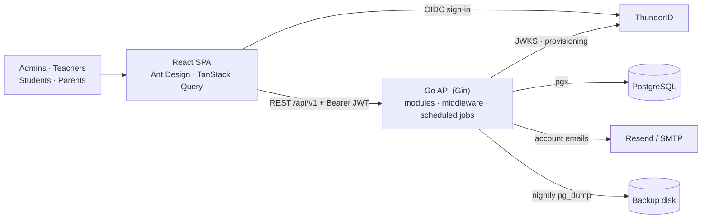

# Architecture

How OpenSchool is put together. For *what* it does see
[`FEATURES.md`](./FEATURES.md); for *why* non-obvious decisions were made
see [`adr/`](./adr/). The detail lives in [`architecture/`](./architecture/):

| Topic | File |
| --- | --- |
| Go modules, middleware, packages, database access rules | [Backend](./architecture/backend.md) |
| Scheduled maintenance agents | [Background jobs](./architecture/background-jobs.md) |
| React app, feature folders, layer rules | [Frontend](./architecture/frontend.md) |
| Tables by area and key relationships | [Data model](./architecture/data-model.md) |
| ThunderID, REST API, outbound mail | [External interfaces](./architecture/external-interfaces.md) |
| Security, reliability, performance, maintainability | [Security and operations](./architecture/security-and-operations.md) |

## System overview

OpenSchool is one Go API binary plus a static React build, backed by one
PostgreSQL database. It needs a running ThunderID for sign-in and account
provisioning, and a mail provider (Resend or SMTP) for password reset and
activation emails. There is no separate worker process, queue or cache:
scheduled jobs run inside the API binary on the same connection pool, and
every read goes to Postgres.

- **Backend:** a modular monolith. Each capability in
  `internal/modules/<name>` owns its routes, use cases and a `repository.go`
  adapter, the only file allowed to use generated `db/sqlc` code;
  `internal/app` wires modules together. See [Backend](./architecture/backend.md).
- **Frontend:** one folder per feature in `src/features/<name>` with `api/`,
  `queries/`, `components/` and `pages/`; the JWT role picks one of four
  portals. See [Frontend](./architecture/frontend.md).
- **Data:** a single school per deployment, scoped by the current academic
  year; schema from versioned migrations applied at startup. See
  [Data model](./architecture/data-model.md).
- **Authorization:** the server is authoritative. Role groups, class and
  student access checks and per-module rules decide every request; the
  frontend only hides what a role cannot use.

## Constraints and assumptions

- **Single school, single current academic year per deployment** - see
  [`adr/0003-single-current-academic-year.md`](./adr/0003-single-current-academic-year.md).
  Not multi-tenant.
- **A running ThunderID instance is a hard dependency** - there is no
  offline sign-in. The API starts while ThunderID is down and recovers
  when it returns.
- **In-app notifications only** - see
  [`adr/0004-in-app-only-notifications.md`](./adr/0004-in-app-only-notifications.md).
  Account emails (reset, activation) are the exception.
- **NIC numbers** are validated loosely (required, non-empty), since valid
  Sri Lankan NICs come in a 9-digit+letter and a 12-digit form.
- **A reverse proxy terminates TLS in production**, and `TRUSTED_PROXIES`
  names it (or `none` for direct access).
- **School time:** `SCHOOL_TIMEZONE` (default Asia/Colombo) defines
  "today" for the API, scheduled jobs and the database session.

## Actors

| Actor | System access |
| --- | --- |
| **Administrator** | Full system access - the only role that can configure school structure, run promotion, publish timetables, and view the audit log/analytics |
| **Principal / Vice Principal** | `teacher`-role account with an elevated in-app position - broad or whole-school notification reach |
| **Section Head / Class Teacher / Subject Teacher** | `teacher`-role account with a narrower in-app position - attendance, timetable build/review, and notifications scoped to their assignment |
| **Teacher (no position)** | Attendance marking, own classes/timetable, scoped notifications |
| **Student** | View-only: own profile, attendance, marks, timetable |
| **Parent/Guardian** | View-only: linked children's attendance, marks, timetable |

Server-side authorization is authoritative for every actor above;
frontend restrictions are a convenience layer, not a security boundary.
