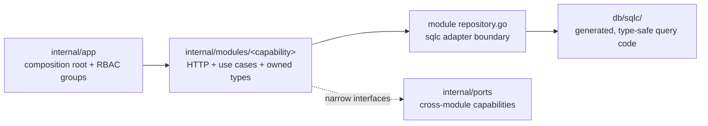

# Backend architecture

Part of the [architecture overview](../ARCHITECTURE.md).

Go, using the [Gin](https://gin-gonic.com/) HTTP framework and
[pgx](https://github.com/jackc/pgx)/[sqlc](https://sqlc.dev/) for
database access. The backend is a modular monolith: each business capability
owns its HTTP boundary, use cases, persistence adapter, and focused tests.



## Dependency rules

```text
cmd/api -> internal/app -> internal/modules
                              |-> handlers/use cases
                              |-> module contracts
                              `-> repository adapters -> db/sqlc -> PostgreSQL
```

- `internal/app` is the composition root and process-level module registry.
- `internal/modules/<name>` owns the HTTP, application, and persistence code for
  one business capability.
- Module handlers depend on use cases, never repositories or generated sqlc.
- sqlc types stay inside `repository.go` adapters (or `repository_<area>.go` when a large one is split) and are mapped to module types.
- Cross-module dependencies use narrow consumer-owned interfaces and are wired
  by `internal/app`.
- `internal/platform` is reserved for shared technical infrastructure; business
  behavior must not be placed there.

## Packages

- **`internal/app/`** - the composition root. `app.go` orchestrates focused
  capability wiring files, which create shared adapters and inject them into
  feature modules through authorization-scoped Gin groups.
- **`internal/modules/`** - capability-oriented vertical slices such as
  School, People, Academics, Attendance, Identity, and Timetable. HTTP
  handlers depend on module use cases; use cases depend on narrow interfaces.
- **Module `repository.go` files** (and `repository_<area>.go` splits of them) - the only module files allowed to import
  `db/sqlc`. They map generated rows into module-owned types before returning.
- **`internal/ports/`** - narrow contracts for capabilities shared across
  modules, preventing one module from reaching into another module's storage.
- **Module route files** - each capability registers its own endpoints onto
  authorization-scoped groups supplied by `internal/app`; no central route
  compatibility package sits between the composition root and modules.
- **Module model files** - request/response and read-model contracts live with
  the capability that owns them. Generated database rows remain isolated in
  `db/sqlc/models.go`.

Cross-cutting packages:

- **`internal/middleware/`** - `AuthMiddleware` (JWT validation against
  ThunderID's JWKS, RS256, issuer-checked, expiry required; the audience is
  not checked today, see [decision V1](../development/issue.md)), `RequireRole`, `RequireStudentAccess`
  (a third authorization primitive - used where the caller must additionally
  own or be linked to the specific student record in the URL, not just hold
  a role), `RateLimit` (per-IP token bucket, applied globally) and the
  separate `PerAccountRateLimit` (per-authenticated-subject token bucket,
  applied only inside the `protected` route group, on top of the per-IP
  one), `BodySizeLimit` (caps every request body at 5 MiB via
  `http.MaxBytesReader`, since Gin applies no cap by default), `SecurityHeaders`,
  `PerJSONFieldRateLimit` (per-code and per-identifier limits on reset and
  activation), `RequestID`, `RequestTimeout`, structured request logging,
  `CacheReference` (ETag caching of reference data) and Prometheus metrics.
- **`RequireClassAccess` / `RequireStudentWorkAccess`** - admins pass; a
  teacher passes only for a class they teach (class or subject teacher) or
  lead (section head, vice principal scope, principal), or a student in
  such a class. The rule is `ports.ClassAccess`, implemented once by the
  leadership module and used by rosters, enrolment and portfolio writes.
- **`internal/apierror/`** - `RespondInternal` logs the real error with a
  request id and returns a generic 500; `Respond` maps not-found,
  duplicate and in-use database errors to safe messages and passes
  hand-written business messages through as 400.
- **`internal/idp/`** - the provider-neutral seam
  (`Provider` interface: `CreateUser`/`UpdateUser`/`DeleteUser`/`AssignRole`)
  that `internal/thunderid` implements. See
  [`adr/0001-thunderid-as-sole-identity-provider.md`](../adr/0001-thunderid-as-sole-identity-provider.md).
- **`internal/authz/`** - application role constants and token-role
  resolution. This is intentionally separate from both the external IdP seam
  and the `/me` and reconciliation workflows in `internal/modules/identity`.
- **`internal/modules/automation/`** - an in-process, cron-scheduled (`robfig/cron/v3`)
  background job runner, started/stopped alongside the HTTP server from
  `main.go` (`scheduler.Start()`/`defer scheduler.Stop()`) - not a separate
  worker process or external queue. See [background jobs](./background-jobs.md).
- **`internal/mailer/`** and **`internal/emails/`** - account emails
  (password reset and activation). `mailer` delivers through Resend,
  SMTP or, in development, the server log; `emails` renders the branded
  templates. Production refuses the console provider. See
  [ADR 0009](../adr/0009-transactional-email.md) and [outbound mail](./external-interfaces.md#outbound-mail).
- **`internal/database/`** - DSN construction, pool setup, and the
  `golang-migrate` runner invoked automatically on startup.
- **`internal/config/`** - `.env` loading via `godotenv`.

## Database access

**Database access rule:** all SQL lives in `backend/db/queries/*.sql`,
annotated for `sqlc`; running `sqlc generate` regenerates
`backend/db/sqlc/`, which is never hand-edited. Schema is defined
entirely by the versioned migrations in `backend/db/migrations/`
(currently 56), applied automatically on every backend startup.
