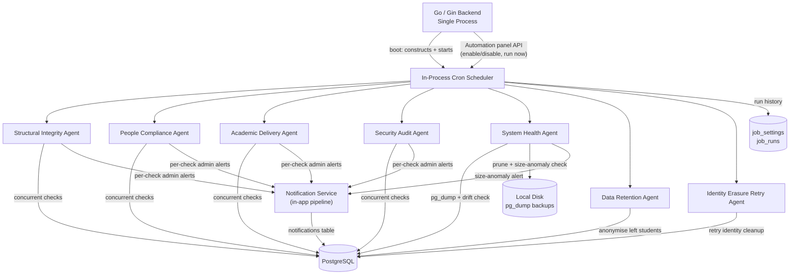

# Background jobs (agents)

Part of the [architecture overview](../ARCHITECTURE.md).

`internal/modules/automation` runs read-mostly maintenance/ops checks on their own cron
schedules, inside the same binary and `pgxpool` as the API - no separate
worker, queue, or LLM/AI call anywhere in the path (every check is SQL
plus arithmetic). Each **agent** implements a small `Job` interface
(`Name`/`Schedule`/`Description`/`Run`) and runs its own checks
concurrently (`runChecks`, goroutines + `sync.WaitGroup`, so one failing
check can't hide what the others found). `Scheduler` ticks each agent,
records every run in `job_settings`/`job_runs`, guards against an agent
overlapping itself, and recovers panics. Admins enable/disable and
manually trigger agents from the **Automation** panel; the system-health
agent (backup) is the one exception that can't be disabled.

| Agent | Schedule | Checks |
| --- | --- | --- |
| `structural_integrity_agent` | daily 03:00 | current-academic-year invariant, student gender vs. school type, empty grades/streams, unclassed students |
| `people_compliance_agent` | daily 05:00 | inactive teachers still assigned, zero-guardian students, teacher/student onboarding (severity rises with age) |
| `academic_delivery_agent` | weekdays 12:00 | missing/inconsistent attendance sessions, stale sessions, term-marks deadline and pace-behind-schedule |
| `security_audit_agent` | hourly | per-actor statistical audit-log anomaly detection, off-hours activity, expired reset and activation link sweep |
| `system_health_agent` | daily 02:00 | nightly `pg_dump`, migration-drift check, backup retention pruning, backup size-anomaly detection |
| `data_retention_agent` | daily 03:00 | anonymises students' personal data a set number of years after they leave, keeping marks and attendance attributable |
| `identity_erasure_retry_agent` | hourly | retries identity cleanup (local user scrub, identity-provider deletion) that failed after a profile was anonymised |

Each check sends its own titled, categorized notification, so the
frontend's `AgentFindingsBanner` can match on that title and surface a
finding on the correct admin page even though several checks share one
agent. There is no separate alerting channel - see
[`adr/0004-in-app-only-notifications.md`](../adr/0004-in-app-only-notifications.md).

Each job also takes a Postgres advisory lock named after it, so with more
than one API replica only one runs a given job at a time. Schedules follow
`SCHOOL_TIMEZONE` (default Asia/Colombo).
