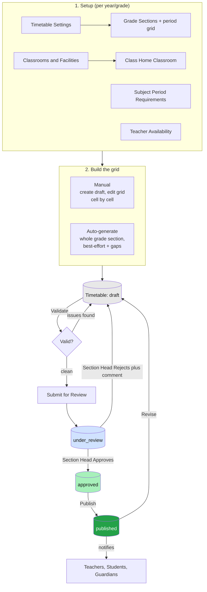
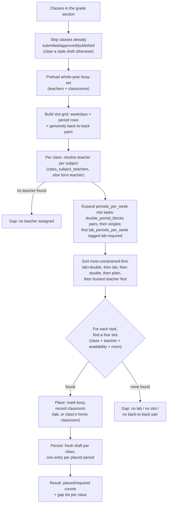

# Timetable

Part of the [feature guide](../FEATURES.md).

Modeled on how a real Sri Lankan school actually runs: **students stay in
one fixed homeroom all day** - they never move between periods - and
**teachers rotate in** to teach each subject. Two exceptions to the fixed
homeroom: a subject can require some of its weekly periods to happen in a
special-purpose **Lab** (tagged to exactly one subject, e.g. a Science Lab)
or an **ECA** facility (Library, Music Room, Auditorium, etc., not tied to
any subject); and a subject can run some of its weekly periods as a
**double period** - two back-to-back periods of the same subject/teacher/
room in one sitting, common for AL (Grade 12/13) subjects - without that
being all-or-nothing (a subject can have, say, 6 periods/week with only 1
or 2 of those doubled and the rest single).

A class's timetable moves through a config → build → validate → review →
publish pipeline. Building the grid can be done by hand or auto-generated;
everything downstream of that (validate/submit/review/publish) is identical
either way.

### 1. Setup (once per academic year / grade - independent of any one class)

| # | What | Where | Notes |
|---|------|-------|-------|
| 1 | **Timetable Settings** | `/timetable-settings` | The school's default daily schedule template (start/end time, period count, period/interval duration) for the current academic year - used only to auto-generate a *starting* period grid, never read directly when scheduling. |
| 2 | **Grade Sections** | `/timetable-settings` (Grade Interval Times tab) / `/grade-sections` | Named groups of grades that share one period grid and one Section Head reviewer (e.g. Primary, Junior Secondary, Senior Secondary, A/L). A section's grid (`timetable_periods`) can be regenerated from Timetable Settings and hand-edited afterward - rows are either a `period` (with a `period_number`) or an `interval`/break, ordered by `sort_order`. The day dimension isn't in the grid at all; it lives on each timetable entry (`day_of_week` 1–5, Mon–Fri). |
| 3 | **Resources & facilities** | `/resources` | Every physical room. `room_type` is `regular` (a class's homeroom), `lab` (tagged to exactly one `subject_id` - the auto-generator only ever sends a subject's lab periods to a lab tagged to *that* subject), or `eca` (not subject-tied). School Setup's optional "Rooms & Facilities" step can bulk-create common presets (Library, Music Room, IT Room, Science Lab, Auditorium) as `eca` rooms at setup time - subjects don't exist yet at that point, so a preset like "IT Room" is re-typed into a proper subject-tagged Lab later, once Subjects are set up. |
| 4 | **Class → Home Classroom** | `/classes` (Add/Edit Class) | Each `Class` (e.g. "10-A") can point at one `regular` classroom as its fixed homeroom (`classes.home_classroom_id`) - this is what "students don't move" means concretely. Adding a class auto-suggests a `regular` classroom whose name exactly matches the class name (the common convention - class "13-M1" sits in room "13-M1"); if none exists, one is created automatically on save. An admin can still pick a different room or a different existing one at any time. |
| 5 | **Subject Period Requirements** | `/subject-requirements` | Per grade, per subject: `periods_per_week`, how many of those must be in a matching Lab (`lab_periods_per_week`), and how many should run as double-period blocks (`double_period_blocks` - a *count of 2-period pairs*, capped at `⌊periods_per_week / 2⌋`, not a flag). Validated against before a timetable can be submitted for review. |
| 6 | **Teacher Availability** | per-teacher | Which day/period slots a teacher is unavailable (`teacher_availability`) - absence of a row means available. Checked both by the manual editor's Validate action and by the auto-generator. |

### 2. Building the grid - manual or auto-generated

**Manual** - `/timetables`: create a draft for a class (or copy an existing
timetable as a template, or start a **Revise** from a published one), then
hand-edit the period × day grid, assigning subject/teacher/classroom to
each cell one at a time.

**Auto-generate** - `/timetables/generate`: one click best-effort fills (or
replaces) DRAFT timetables for **every class in a grade section at once**.
Scoped to a whole section, not one class, because teachers and Lab/ECA
rooms are *shared* across a section's classes - generating them in
isolation couldn't avoid double-booking a shared resource. It:

1. Skips any class that already has a submitted/approved/published
   timetable this year (reported, untouched); clears a stale draft first if
   one exists, so re-running is idempotent.
2. Builds one shared candidate slot grid from the section's period rows ×
   weekdays, plus the set of genuinely back-to-back period pairs (adjacent
   in the grid with no interval between them - what a double period is
   allowed to use).
3. For every class, resolves each required subject's teacher from
   `class_subject_teachers`, falling back to the class's form teacher if no
   explicit assignment exists (same bypass the manual Validate action
   grants a form teacher) - a subject with neither is reported as a gap.
4. Expands each subject's `periods_per_week` into placement tasks:
   `double_period_blocks` back-to-back pairs first, then the remaining
   periods as singles; the first `lab_periods_per_week` periods in that
   sequence are tagged lab-required.
5. Places tasks most-constrained-first (lab-requiring and double-period
   tasks before plain ones, then busier teachers before lighter ones),
   searching a deterministically-shuffled slot list per class+subject
   (preferring a day that subject hasn't used yet, to spread it across the
   week) - checking the class, the teacher (busy-set *and* availability),
   and the classroom (a matching Lab, or the class's home classroom) are
   all free. A placed regular period's classroom is set to the class's home
   classroom too, not left blank, so double-booking checks stay meaningful
   for homerooms as well as labs.
6. Anything it can't place - no teacher, no free slot, no matching lab, no
   back-to-back pair available - is left as a **gap** with a specific
   reason, not silently dropped or hard-failed; the resulting draft is a
   perfectly normal one an admin finishes by hand in the manual editor.

### 3. Validate → Submit → Review → Publish (identical for both build paths)

- **Validate** - checks teacher double-booking and classroom double-booking
  across every other timetable in the academic year, teacher-marked
  unavailability, the entry's teacher actually being the class's assigned
  subject teacher (or its form teacher), and unmet weekly period counts
  against Subject Period Requirements.
- **Submit for Review** - only once Validate is clean; notifies the grade's
  Section Head/TIC.
- **Approve / Reject** - by an authorized reviewer (a Section Head for a
  grade they head, via `section_heads`/`grade_sections`), with a required
  comment on rejection.
- **Publish** - archives the previous published version for that class/
  year, notifies every affected teacher/student/guardian.
- **Revise** - clones a published timetable into a new chained draft
  (`parent_timetable_id`) without losing the published version's history.

Every status transition is recorded in `timetable_status_history` and fires
an in-app notification.

### 4. Who sees what

- **Section Head** - a "Review Timetables" nav item and a dashboard panel
  to approve/reject, scoped to the grades they head; hidden entirely for
  Class/Subject Teachers, whose review queue would always be empty.
- **Principal / Vice Principal** - a read-only "All Timetables" view
  (`/t/all-timetables`) and Analytics, school-wide - they monitor, they
  don't build or approve (see [Roles & positions](./roles-and-accounts.md#roles--positions)
  above).
- **Class/Subject Teacher** - "My Timetable" (their own weekly schedule
  across every class they teach) and "My Classes".
- **Students / Guardians** - the published timetable for their own class /
  their child's class.

### Flow

Auto-generate's internal placement logic, per grade section:

